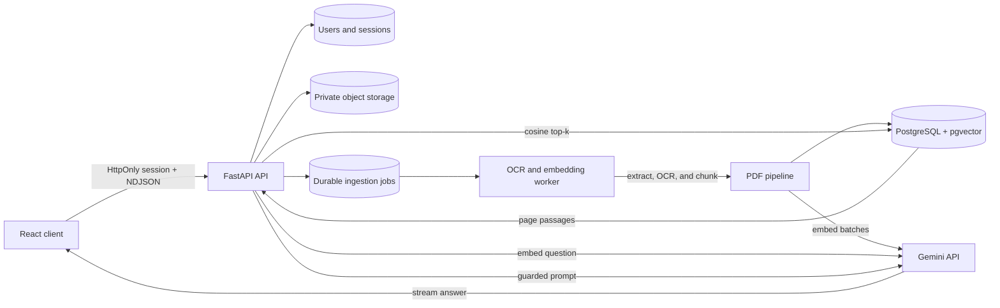

# Sourcebeam — grounded answers from documents and images

Sourcebeam is a full-stack, multimodal AI workspace for asking questions about private PDF documents and images. It extracts and chunks searchable PDFs, creates Gemini embeddings, retrieves the most relevant passages with pgvector, analyzes sanitized image attachments, and streams answers with page-level evidence.

This is more than a thin chat wrapper: it includes user isolation, revocable server-side sessions, document lifecycle management, semantic retrieval, prompt-injection defenses, citations, streaming, migrations, rate limits, and automated tests.

## What it demonstrates

- Retrieval-augmented generation (RAG) with normalized 768-dimensional embeddings
- Hybrid pgvector cosine + PostgreSQL full-text retrieval with HNSW and rank fusion
- Gemini relevance reranking before grounded generation
- OCR fallback for scanned PDFs using Tesseract and Poppler
- Durable background ingestion jobs with retries and progress
- Private local or S3-compatible object storage for original PDFs and images
- Async FastAPI and SQLAlchemy 2.0 APIs
- Streaming NDJSON responses and persisted conversation history
- React document library, conversation attachments, Markdown answers, and evidence drawer
- Private JPEG/PNG/WebP chat attachments with visual question answering
- HttpOnly cookie authentication with Argon2 password hashing and revocable sessions
- Per-user authorization across chats, documents, chunks, and attachments
- File validation, bounded extraction, rate limiting, timeouts, and concurrency controls
- Alembic migrations, retrieval evaluation metrics, and browser/API tests

## Architecture



Original PDFs and sanitized images are retained in private object storage. PostgreSQL stores ownership and processing metadata, extracted chunks, embeddings, and storage keys. Retrieval and media access are always restricted to the authenticated owner.

## Repository layout

```text
app/
  api/routes/       Auth, conversations, documents, and task endpoints
  core/             Configuration, logging, security, and rate limiting
  db/               Async engine and declarative base
  schemas/          Request and response contracts
  services/         Gemini and RAG pipelines
alembic/             Versioned PostgreSQL schema migrations
docs/RAG_GUIDE.md    RAG implementation notes and tradeoffs
tests/               Async API, authorization, security, and RAG tests
```

The React client currently lives in the sibling `py-frontend` directory. For a public release, publish both folders in one repository (`backend/` and `frontend/`) or link the two repositories clearly from each README.

## Run locally

### 1. Start the complete Docker stack

```powershell
Copy-Item .env.docker.example .env.docker
docker compose --env-file .env.docker up --build
```

This starts PostgreSQL/pgvector, MinIO object storage, FastAPI, the ingestion worker, and the production React frontend. Open `http://localhost:5173`; the MinIO development console is at `http://localhost:9001`.

For manual development, start only `postgres` and `minio`, configure matching values in `.env`, then continue below.

### 2. Configure and start the API

Use Python 3.12 or newer.

```powershell
python -m venv .venv
.venv\Scripts\Activate.ps1
python -m pip install -r requirements.txt
Copy-Item .env.example .env
```

Set a real `GEMINI_API_KEY` and generate `JWT_SECRET_KEY` using the command documented in `.env.example`, then run:

```powershell
python -m alembic upgrade head
python run_server.py
```

In another terminal, start the ingestion worker:

```powershell
python worker.py
```

The API is available at `http://127.0.0.1:8000`, interactive docs at `/docs`, liveness at `/health/live`, and dependency readiness at `/health/ready`.

### 3. Start the React client

From the sibling frontend directory:

```powershell
Copy-Item .env.example .env
npm install
npm run dev
```

Open `http://localhost:5173`, create an account, and either upload a searchable PDF in **Knowledge base** or use the image button in the composer. Ask a question, then open **grounded sources** under a PDF-based answer to inspect the retrieved passages, pages, and semantic match scores.

## Tests and quality checks

```powershell
python -m pytest -q
python -m evals.run
```

From `py-frontend`:

```powershell
npm run lint
npm run build
npm run test:e2e
```

The backend suite covers authentication, session revocation, tenant isolation, rate limits, conversation streaming, PDF validation, document ownership, citations, grounding instructions, and configuration safety.

## API highlights

| Endpoint | Purpose |
| --- | --- |
| `POST /api/auth/register` | Create an account and secure session |
| `GET /api/conversations` | List the current user's conversations |
| `POST /api/conversations/{id}/messages/stream` | Retrieve context and stream an answer |
| `POST /api/documents` | Validate/store a PDF and queue background ingestion |
| `GET /api/documents/{id}/content` | Privately stream an owned original PDF |
| `POST /api/conversations/{id}/images` | Sanitize and privately attach an image |
| `GET /api/images/{id}/content` | Read an owned image attachment |
| `PUT /api/conversations/{id}/documents/{document_id}` | Attach an existing document |
| `GET /health/ready` | Verify database readiness |

## Security and privacy decisions

- Passwords are hashed with Argon2; raw passwords are never stored.
- JWTs are short-lived, scoped by issuer/audience, stored in HttpOnly cookies, and backed by revocable database sessions.
- Every data query is scoped to the authenticated user.
- PDF text is explicitly treated as untrusted data, so instructions inside documents cannot override the grounding prompt.
- Images are signature-checked, dimension-bounded, EXIF-stripped, re-encoded, and treated as untrusted multimodal data.
- Upload size, page count, extracted characters, prompt size, AI concurrency, and request duration are bounded.
- API errors avoid exposing provider details or stack traces.
- `.env` and local databases are excluded from version control.

Before publishing, rotate any API key or database credential that has ever been committed or shared, even if it was later deleted.

## Known limitations

- Rate limiting is process-local; multiple API instances need Redis or gateway-level limits.
- OCR quality depends on scan clarity and installed language packs.
- Gemini reranking improves relevance but adds one bounded provider call and can be disabled.
- The included groundedness metric is conservative and lexical; production evaluation should add reviewed human or model judgments.

## High-value next steps

1. Expand the evaluation set with domain-specific and adversarial cases.
2. Add multilingual OCR language packs and table-aware extraction.
3. Export latency, cost, and retrieval-quality telemetry to a monitoring backend.
4. Deploy the included production stack behind HTTPS and managed secrets.

See [docs/RAG_GUIDE.md](docs/RAG_GUIDE.md) for the retrieval design and implementation details.
